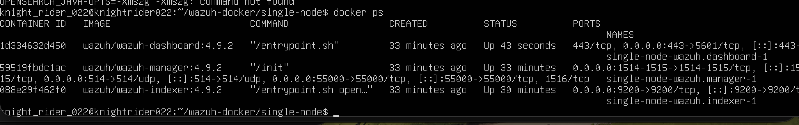
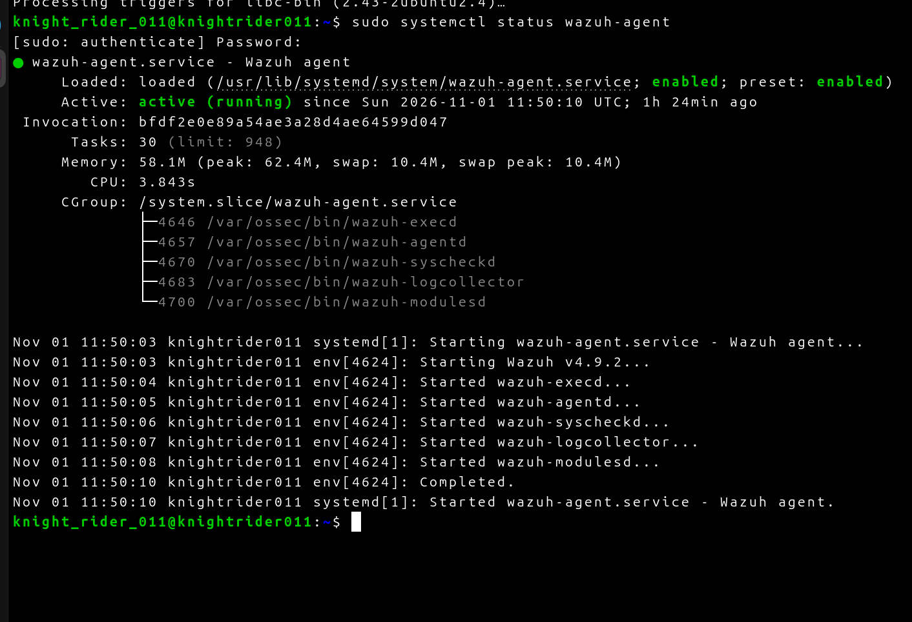

# Wazuh SIEM Home Lab

## Project Overview
Deployed a fully functional Wazuh SIEM (Security Information and Event Management) home lab on a MacBook Air (Apple Silicon) using UTM for virtualization. The goal was to centralize log collection and implement custom detection engineering.

## Architecture
- **Manager Node:** Ubuntu Server (Intel x86_64 emulated via QEMU), running Wazuh 4.9.2 via Docker.
- **Endpoint Node:** Ubuntu Desktop (ARM64 native), running Wazuh Agent 4.9.2.
- **Networking:** UTM Port Forwarding (Host `127.0.0.1:9443` -> Guest `10.0.2.15:443`).

## Detection Engineering
Wrote a custom correlation rule to detect SSH brute-force attempts by monitoring built-in authentication failure logs (Rule ID 5760).

### Custom Rule (`local_rules.xml`)
```xml
<rule id="100101" level="10">
  <if_sid>5760</if_sid>
  <description>SSH Brute Force Attempt Detected (Custom Correlation)</description>
  <group>ssh,authentication_failed,custom</group>
</rule>
```
## Challenges & Troubleshooting (The "Real World" Experience)
...

Building an enterprise SIEM on an Apple Silicon Mac required navigating several infrastructure and emulation hurdles:

1. **Cross-Architecture Emulation:** 
   * *Challenge:* The official Wazuh Docker images are built for AMD64 (Intel) architecture, but the host Mac is ARM64. 
   * *Solution:* Installed QEMU user-static emulation and utilized `tonistiigi/binfmt` to allow the ARM64 Linux kernel to execute x86_64 Docker containers, successfully bypassing `exec format error` crashes.

2. **Docker Configuration & File System Errors:**
   * *Challenge:* Encountered `EISDIR` and `bad indentation of a mapping entry` errors during container initialization. 
   * *Solution:* Diagnosed that Docker had created a directory instead of a text file due to a broken volume mount, and manually corrected the YAML syntax in `wazuh.yml` to ensure proper API handshakes.

3. **Virtual Network Routing & Agent Ingestion:**
   * *Challenge:* The Endpoint agent could not communicate with the Manager due to UTM's isolated virtual network modes (Shared Network vs. Bridged vs. Emulated VLAN).
   * *Solution:* Reconfigured network topologies, implemented port forwarding (`127.0.0.1:9443` -> Guest `443`), and corrected the agent's `ossec.conf` to point to the Manager's static IP, ensuring seamless telemetry flow.
4. **API Timeout Mitigation:**
   * *Challenge:* The Wazuh Dashboard timed out waiting for the Indexer (database) to respond under emulation load.
   * *Solution:* Manually injected a custom `timeout: 120000` parameter into the dashboard's configuration file to accommodate the latency of the QEMU emulation layer.

   ## Proof of Deployment

### 1. Wazuh Manager Stack Running
All three Docker containers (Dashboard, Manager, and Indexer) are actively running on the Intel-emulated Ubuntu VM.


### 2. Wazuh Agent Active on Endpoint
The Wazuh agent is installed, enabled, and actively running on the ARM64 Ubuntu Endpoint VM.



